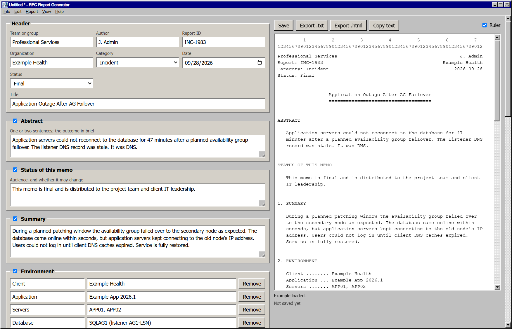

# RFC-Report-Generator

```
Blame DNS                                                     michaelmcg
Request for Comments: README                           rfc.blame-dns.dev
Category: Informational                                   September 2026
Status: It was DNS

                          RFC Report Generator
                          ====================
```


Write incident and change reports the way the internet writes its standards:
plain text, 72 columns, no fonts to fight with. It pastes cleanly into any
ticket, email or chat, and it still reads well when someone prints it.



## Get it

Download the installer or the portable exe from
[Releases](https://github.com/michaelmcg/RFC-Report-Generator/releases),
or visit the homepage at <https://rfc.blame-dns.dev>.

| File                                | Pick it if                                    |
|-------------------------------------|-----------------------------------------------|
| `RFC-Report-Generator-Setup.exe`    | You want a Start menu entry and file links    |
| `RFC-Report-Generator-Portable.exe` | You want to run it from a folder or USB drive |

It runs on Windows 10 or 11, 64-bit. The exes are not code-signed yet, so
SmartScreen may frown at you on first run. Choose More info, then Run anyway.

## What's in the box

- **Live preview.** The report updates as you type, with a column ruler. Any
  line over 72 characters lights up.
- **Sections for each category.** An Incident gets a root cause. A Change gets
  an implementation plan, a rollback plan and approvals. An Upgrade adds a
  table of versions.
- **Untick anything.** A section you untick leaves the report, and the rest
  renumber. The app keeps the text in case you change your mind.
- **Crash recovery.** The app keeps a copy of unsaved changes. If the power
  goes out mid-outage, it offers them back on the next start.
- **Recent files.** The last 8 reports sit at the bottom of the File menu,
  numbered, the way Windows 95 intended.
- **Spell check.** Right-click a misspelled word for suggestions.
- **Export anywhere.** Save as `.txt` or `.html`, or copy the text.
- **Windows 95 look.** Beveled buttons, a navy title bar and pixel-perfect menus.
  There is a dark theme too, for 2am.

## Make it yours

Edit > Settings sets what every new report starts with:

- Team, author, organization and category
- Time zone and status of this memo
- The author's address
- The sections for each category
- Your own Status choices, one per line (Draft, Pending, Blame Accepted...).
  The first choice is the default.

The settings never change a report that you open.

The app keeps its settings, theme, ruler setting and recent files in
`settings.json`, and the copy of unsaved changes in `recovery.json`. Both
files are in the app's user data folder.

## Keyboard shortcuts

For those who never really left 1995:

| Action                 | Shortcut              |
|------------------------|-----------------------|
| New                    | Ctrl+N                |
| Open                   | Ctrl+O                |
| Save / Save As         | Ctrl+S / Ctrl+Shift+S |
| Export as text         | Ctrl+E                |
| Export as HTML         | Ctrl+Shift+E          |
| Copy report text       | Ctrl+Shift+C          |
| Show or hide the ruler | Ctrl+L                |
| Settings               | Ctrl+,                |

Alt and the underlined letter open a menu, as they always have.

## FAQ

**Was it DNS?**
Yes.

**What if it was not DNS?**
Check again. Then untick the Root cause section and write it up anyway.

## Built with

- **[Electron](https://www.electronjs.org/) 44** runs the app: one window, sandboxed,
  with a strict content security policy.
- **Plain JavaScript, HTML and CSS.** No framework and no runtime dependencies.
  The Windows 95 title bar, menus and message boxes are drawn in the page.
- **Node.js** runs the formatter tests, with nothing but `node:assert`.
- **[electron-builder](https://www.electron.build/)** makes the installer (NSIS)
  and the portable exe.
- **GitHub Actions** runs the tests and builds each release.

To report a security problem, see [SECURITY.md](SECURITY.md).

## Build it yourself

You need Node.js 22.12 or later.

```
npm install
npm start               # run the app
npm test                # run the formatter tests
npm run dist            # build the installer and portable exe in dist/
npm run dist:portable   # build the portable exe only
```

## Where things live

| Path              | Contents                                             |
|-------------------|------------------------------------------------------|
| `main.js`         | Window, menus, file dialogs, recovery, recent files  |
| `preload.js`      | The bridge between the page and Node                 |
| `src/report.js`   | Report model, templates and text formatter           |
| `src/app.js`      | Form, preview, save, open and export                 |
| `src/chrome.js`   | Windows 95 title bar and menu bar                    |
| `src/dialog.js`   | Windows 95 message boxes                             |
| `src/settings.js` | The Settings dialog                                  |
| `src/index.html`  | Page layout                                          |
| `test/`           | Formatter tests                                      |
| `build/`          | Icon artwork for the build. The app does not use it. |
| `site/`           | The homepage and the screenshot                      |

## File format

A `.rfcreport` file is plain JSON, so it diffs cleanly in Git:

```
{ "format": "rfc-report", "version": 1, "state": { ... } }
```

When you open an older file, the app fills in any missing fields with
defaults. On Windows, exported `.txt` files use CRLF line endings, so Notepad
stays happy.

## License

MIT. See [LICENSE](LICENSE).
